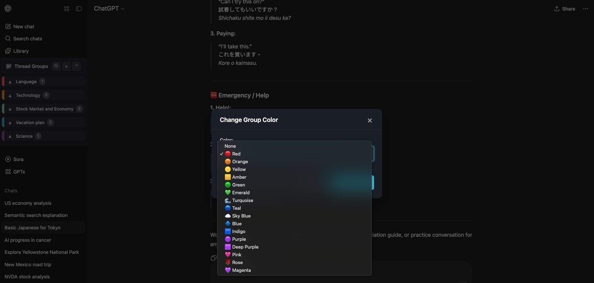
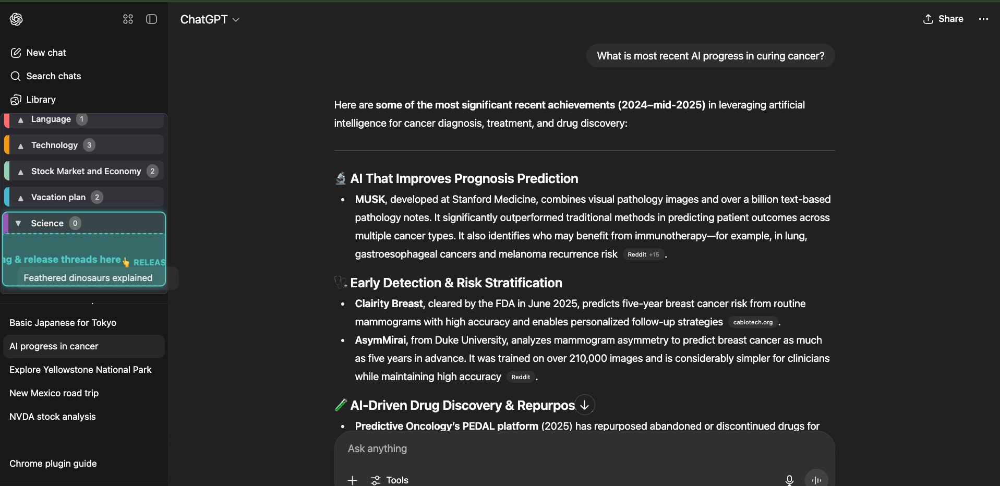
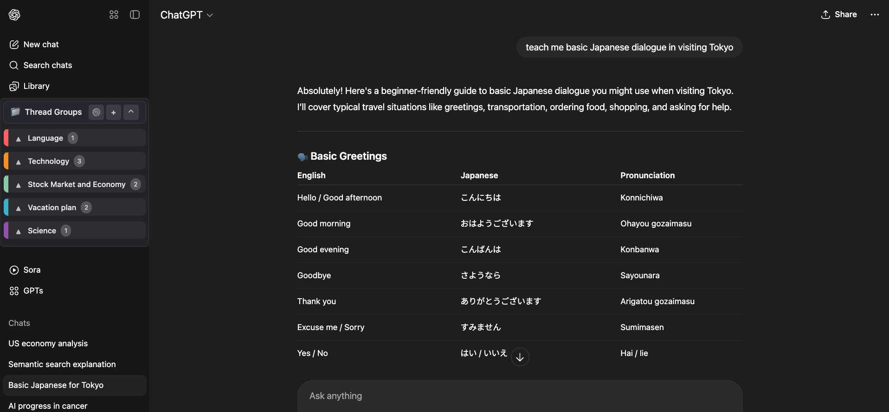
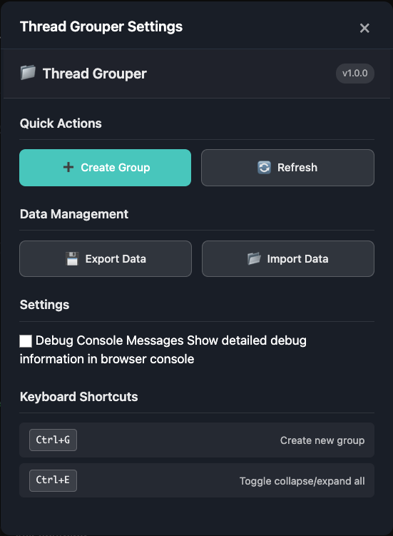

# ChatGPT Thread Grouper

**Organize your ChatGPT conversations into custom groups for better management and navigation.**

Transform your ChatGPT experience with powerful conversation organization tools. Never lose track of important discussions again!

## 🌍 Multi-Language Support

**ChatGPT Thread Grouper** is available in multiple languages. Click below to jump to your preferred language:

🇹🇼 [繁體中文](#-繁體中文) | 🇪🇸 [Español](#-español) | 🇫🇷 [Français](#-français) | 🇩🇪 [Deutsch](#-deutsch) | 🇮🇹 [Italiano](#-italiano) | 🇯🇵 [日本語](#-日本語) | 🇰🇷 [한국어](#-한국어) | 🇵🇹 [Português](#-português)

---

## ✨ Features

### 🎨 **Colorful Group Management**
Create custom groups with personalized colors and names to categorize your conversations by topic, project, or priority.

### 🎯 **Drag and Drop Magic**
Effortlessly organize your conversations with intuitive drag-and-drop functionality. Move threads between groups with a simple mouse gesture.

### 🔄 **Dual Interface Excellence**
Experience the best of both worlds - your organized groups alongside ChatGPT's original interface. Switch between views seamlessly.

### ⚙️ **Settings and Data Management**
Complete control over your data with export/import functionality, customizable settings, and debug options for power users.

### 📚 **Prompt Library**
Create, save, and organize your favorite prompts for quick access. Send prompts directly to ChatGPT with one click, complete with system and user message templates.

### 🌍 **Multi-Language Support**
Fully localized interface supporting 10 languages including English, Spanish, French, German, Italian, Japanese, Korean, Portuguese, and Traditional Chinese. Switch languages in real-time from the settings.

## 🚀 Why You'll Love It

**🗂️ Stay Organized**
- Never lose important conversations in an endless scroll
- Group related discussions together for easy access
- Visual color coding for instant recognition

**⚡ Save Time**
- Find conversations instantly instead of scrolling endlessly
- Quick keyboard shortcuts for power users
- Drag-and-drop organization in seconds

**🔒 Privacy First**
- All data stored locally on your device
- No external servers or data sharing
- Complete control over your conversation organization

**🎨 Customizable**
- Choose your own group colors and names
- Collapsible groups for a clean interface
- Works seamlessly with ChatGPT's existing design

**📚 Boost Productivity**
- Save and reuse your best prompts with the prompt library
- One-click prompt sending to ChatGPT
- Organize prompts by categories for easy access

**🌍 Global Accessibility**
- Interface available in 10 languages
- Real-time language switching
- Localized experience for users worldwide

## 📥 Installation

### From Chrome Web Store (Recommended)
1. Visit the [Chrome Web Store page: "ChatGPT Thread Grouper"](https://chromewebstore.google.com/detail/chatgpt-thread-grouper/jlmkhdhaeedobmijpbpgbdfiggcppoeg)
2. Click "Add to Chrome"
3. Confirm the installation
4. Visit [ChatGPT](https://chatgpt.com) and start organizing!

### Manual Installation
1. Download the latest release from Releases (Chrome Web Store (TODO Link TBD))
2. Open Chrome Extensions page (`chrome://extensions/`)
3. Enable "Developer mode"
4. Click "Load unpacked" and select the extension folder

## 🎮 How to Use

1. **Visit ChatGPT**: Navigate to [chatgpt.com](https://chatgpt.com)
2. **Create Groups**: Click the "+" button to create your first conversation group
3. **Organize Conversations**: Drag and drop conversations into your groups
4. **Use Prompt Library**: Click the "Prompt Library" button to save and reuse your favorite prompts
5. **Switch Languages**: Change interface language in the settings for a localized experience
6. **Enjoy**: Experience a cleaner, more organized ChatGPT interface!

### ⌨️ Keyboard Shortcuts
- `Ctrl+G` - Create new group
- `Ctrl+P` - Open prompt library
- `Ctrl+E` - Toggle collapse/expand all groups

## 🛠️ Permissions Explained

The extension requires these permissions to function:

- **Storage**: Save your groups and organization preferences locally
- **ActiveTab**: Access ChatGPT pages to add organization features
- **Host Permissions**: Only works on ChatGPT.com and Chat.OpenAI.com
- **Notifications**: Show welcome message on first install

## 💾 Data Management

**Export Your Data**: Backup your conversation organization to a JSON file
**Import Data**: Restore your groups from a backup file
**Local Storage**: Everything stays on your device - no cloud sync required

## 🆘 Support & Feedback

Having issues or want to suggest improvements?

- 🐛 **Report Bugs**: [Submit an Issue](https://github.com/jackycleancode/ChatGptThreadGrouper/issues)
- �� **Feature Requests**: [Suggest Features](https://github.com/jackycleancode/ChatGptThreadGrouper/issues)
- 📧 **Direct Contact**: [jackycleancode@gmail.com](jackycleancode@gmail.com)

## 📋 Changelog

### v1.2.3 (2025-09-01) - Enhanced User Experience
- 🎯 **Drag Between Groups**: Move threads from one group to another with simple drag and drop
- ⚡ **Smooth as Butter**: Lightning-fast navigation with no page refreshes - feels like a native app
- 🐛 **Bug Fixes**: Improved reliability and smoother animations

### v1.2.2 (2025-08-29) - Smooth Navigation
- 🚀 **Seamless Navigation**: Clicking grouped threads now uses smooth SPA-style navigation instead of page reloads
- ⚡ **Native Feel**: Thread navigation feels identical to ChatGPT's original interface
- 🔧 **Technical Enhancement**: Improved navigation compatibility with ChatGPT's routing system

### v1.2.0 (2025-08-17) - Internationalization & Prompt Library
**🎉 Major Features:**
- 🌍 **Multi-language Support**: Added comprehensive internationalization (i18n) with support for 10 languages
  - English, German, Spanish, French, Italian, Japanese, Korean, Portuguese, Traditional Chinese
  - Real-time language switching in popup interface
  - Localized UI elements throughout the extension
- 📚 **Prompt Library**: New feature for managing and reusing prompts
  - Create, save, and organize custom prompts
  - Quick paste functionality with proper line breaks
  - Accessible from settings modal with helpful tips
  - Seamless integration with ChatGPT interface

### v1.1.1 (2025-08-10)
- 🐞 Bug Fixes:
  - Fixed Scholar GPT auto-loading issue
  - Enhanced drag and drop functionality for GPTs-type threads
  - Fixed thread count accuracy when moving between groups

### v1.1.0 (2025-08-05) - First Release
- Initial stable release with core grouping functionality
- Drag and drop organization
- Colorful group management
- Export/import data features

## 🔗 Links

- [Chrome Web Store](https://chromewebstore.google.com/detail/chatgpt-thread-grouper/jlmkhdhaeedobmijpbpgbdfiggcppoeg) 
- [Privacy Policy](PRIVACY_POLICY.md)

## ⭐ Love the Extension?

If ChatGPT Thread Grouper helps organize your conversations, please:
- ⭐ Rate it on the [Chrome Web Store](https://chromewebstore.google.com/detail/chatgpt-thread-grouper/jlmkhdhaeedobmijpbpgbdfiggcppoeg)
- 🐙 Star this repository on GitHub
- 📢 Share it with friends who use ChatGPT

---

**Made with ❤️ for the ChatGPT community**

*Transform your conversation chaos into organized productivity today!*

---

## 🌍 Language-Specific Descriptions

### 🇹🇼 繁體中文
**ChatGPT Thread Grouper** - 將您的 ChatGPT 對話整理成自訂群組，以便更好地管理和導航。

**🎮 使用方法:**
1. **造訪 ChatGPT**: 前往 [chatgpt.com](https://chatgpt.com)
2. **建立群組**: 點擊 "+" 按鈕建立您的第一個對話群組
3. **整理對話**: 將對話拖放至您的群組中
4. **使用提示詞庫**: 點擊 "提示詞庫" 按鈕來儲存和重複使用您喜愛的提示詞
5. **切換語言**: 在設定中更改介面語言以獲得本地化體驗
6. **享受**: 體驗更乾淨、更有組織的 ChatGPT 介面！

### 🇪🇸 Español
**ChatGPT Thread Grouper** - Organiza tus conversaciones de ChatGPT en grupos personalizados para una mejor gestión y navegación.

**🎮 Cómo Usar:**
1. **Visita ChatGPT**: Navega a [chatgpt.com](https://chatgpt.com)
2. **Crea Grupos**: Haz clic en el botón "+" para crear tu primer grupo de conversaciones
3. **Organiza Conversaciones**: Arrastra y suelta conversaciones en tus grupos
4. **Usa la Biblioteca de Prompts**: Haz clic en el botón "Biblioteca de Prompts" para guardar y reutilizar tus prompts favoritos
5. **Cambia Idiomas**: Cambia el idioma de la interfaz en la configuración para una experiencia localizada
6. **¡Disfruta**: ¡Experimenta una interfaz de ChatGPT más limpia y organizada!

### 🇫🇷 Français
**ChatGPT Thread Grouper** - Organisez vos conversations ChatGPT en groupes personnalisés pour une meilleure gestion et navigation.

**🎮 Comment Utiliser:**
1. **Visitez ChatGPT**: Naviguez vers [chatgpt.com](https://chatgpt.com)
2. **Créez des Groupes**: Cliquez sur le bouton "+" pour créer votre premier groupe de conversations
3. **Organisez les Conversations**: Glissez-déposez les conversations dans vos groupes
4. **Utilisez la Bibliothèque de Prompts**: Cliquez sur le bouton "Bibliothèque de Prompts" pour sauvegarder et réutiliser vos prompts favoris
5. **Changez de Langue**: Modifiez la langue de l'interface dans les paramètres pour une expérience localisée
6. **Profitez**: Découvrez une interface ChatGPT plus propre et organisée !

### 🇩🇪 Deutsch
**ChatGPT Thread Grouper** - Organisieren Sie Ihre ChatGPT-Gespräche in benutzerdefinierten Gruppen für bessere Verwaltung und Navigation.

**🎮 Verwendung:**
1. **ChatGPT besuchen**: Navigieren Sie zu [chatgpt.com](https://chatgpt.com)
2. **Gruppen erstellen**: Klicken Sie auf die "+" Schaltfläche, um Ihre erste Gesprächsgruppe zu erstellen
3. **Gespräche organisieren**: Ziehen Sie Gespräche per Drag & Drop in Ihre Gruppen
4. **Prompt-Bibliothek verwenden**: Klicken Sie auf die "Prompt-Bibliothek" Schaltfläche, um Ihre Lieblings-Prompts zu speichern und wiederzuverwenden
5. **Sprache wechseln**: Ändern Sie die Interface-Sprache in den Einstellungen für eine lokalisierte Erfahrung
6. **Genießen**: Erleben Sie eine sauberere, organisiertere ChatGPT-Oberfläche!

### 🇮🇹 Italiano
**ChatGPT Thread Grouper** - Organizza le tue conversazioni ChatGPT in gruppi personalizzati per una migliore gestione e navigazione.

**🎮 Come Usare:**
1. **Visita ChatGPT**: Naviga su [chatgpt.com](https://chatgpt.com)
2. **Crea Gruppi**: Clicca sul pulsante "+" per creare il tuo primo gruppo di conversazioni
3. **Organizza Conversazioni**: Trascina e rilascia le conversazioni nei tuoi gruppi
4. **Usa la Libreria di Prompt**: Clicca sul pulsante "Libreria di Prompt" per salvare e riutilizzare i tuoi prompt preferiti
5. **Cambia Lingua**: Modifica la lingua dell'interfaccia nelle impostazioni per un'esperienza localizzata
6. **Goditi**: Sperimenta un'interfaccia ChatGPT più pulita e organizzata!

### 🇯🇵 日本語
**ChatGPT Thread Grouper** - ChatGPTの会話をカスタムグループに整理して、より良い管理とナビゲーションを実現します。

**🎮 使用方法:**
1. **ChatGPTにアクセス**: [chatgpt.com](https://chatgpt.com) に移動
2. **グループを作成**: "+" ボタンをクリックして最初の会話グループを作成
3. **会話を整理**: 会話をドラッグ＆ドロップでグループに移動
4. **プロンプトライブラリを使用**: "プロンプトライブラリ" ボタンをクリックしてお気に入りのプロンプトを保存・再利用
5. **言語を切り替え**: 設定でインターフェース言語を変更してローカライズされた体験を
6. **楽しむ**: より清潔で整理されたChatGPTインターフェースを体験！

### 🇰🇷 한국어
**ChatGPT Thread Grouper** - ChatGPT 대화를 사용자 정의 그룹으로 구성하여 더 나은 관리와 탐색을 제공합니다.

**🎮 사용 방법:**
1. **ChatGPT 방문**: [chatgpt.com](https://chatgpt.com) 으로 이동
2. **그룹 생성**: "+" 버튼을 클릭하여 첫 번째 대화 그룹 생성
3. **대화 정리**: 대화를 드래그 앤 드롭으로 그룹에 이동
4. **프롬프트 라이브러리 사용**: "프롬프트 라이브러리" 버튼을 클릭하여 즐겨찾기 프롬프트 저장 및 재사용
5. **언어 변경**: 설정에서 인터페이스 언어를 변경하여 현지화된 경험
6. **즐기기**: 더 깔끔하고 정리된 ChatGPT 인터페이스 경험!

### 🇵🇹 Português
**ChatGPT Thread Grouper** - Organize suas conversas do ChatGPT em grupos personalizados para melhor gerenciamento e navegação.

**🎮 Como Usar:**
1. **Visite o ChatGPT**: Navegue para [chatgpt.com](https://chatgpt.com)
2. **Crie Grupos**: Clique no botão "+" para criar seu primeiro grupo de conversas
3. **Organize Conversas**: Arraste e solte conversas em seus grupos
4. **Use a Biblioteca de Prompts**: Clique no botão "Biblioteca de Prompts" para salvar e reutilizar seus prompts favoritos
5. **Mude Idiomas**: Altere o idioma da interface nas configurações para uma experiência localizada
6. **Aproveite**: Experimente uma interface ChatGPT mais limpa e organizada!
